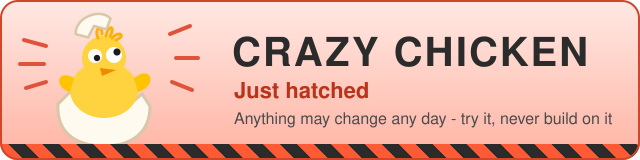

# porelo-host

> **Crazy chicken - just hatched.** Interfaces, formats and even the purpose may change any day. Use it only to try ideas, never to build on.

Brings a server up for Porelo and takes it down again, owned or rented by the hour: an Ansible collection. `up`
prepares the host once with no project and no person - packages, SSH, the firewall, Porelo and its account, the host
program, every published agent, the forge, the VM pool and the homeserver where the host asks for them - and starts
the host's follow of its organization, which admits people and carries projects. At down it refuses while a project's
work is not at its central forge or a person still holds a membership, then takes the forge, the homeserver and the VM
pool off and leaves the machine to be given back; it copies nothing off. What keeps a guarantee stays Porelo's: the
playbook calls the packaged host program and Porelo's own commands.

The [host lifecycle](doc/index.md) explains setup and teardown. The [local forge](doc/local-forge.md) explains
how task work is built and accepted locally, and which steps toward central publication remain unbuilt.

**Requirements**: a host with Ubuntu 26.04; the playbook runs on the host itself, with the `ansible-core` Ubuntu
carries (2.20; the collection needs 2.19 or newer), so the person's computer needs only ssh. Porelo in the version
the collection's own follows (`0.5.13-snapshot`, Porelo 0.5.0 with its host program 0.5.1, a snapshot until Porelo releases it). It is
installed from the tarball a release attaches, `ansible-galaxy collection install porelo-host-<version>.tar.gz`.
Every push to `main` that builds also publishes one as a snapshot on the pre-release `snapshot`,
`https://github.com/porelo-ai/porelo-host/releases/download/snapshot/`: `porelo-host-<version>.<run>.tar.gz`, its
`SHA256SUMS` over the newest five, and `latest.json` naming the newest file, its `sha256` and its `commit`;
`build/check-snapshot.py <directory>` checks the three agree.

**Documentation: [porelo-ai.github.io](https://porelo-ai.github.io)**, all of Porelo's documentation in one site.

[Contributing](CONTRIBUTING.md), and [reporting a vulnerability](SECURITY.md).
